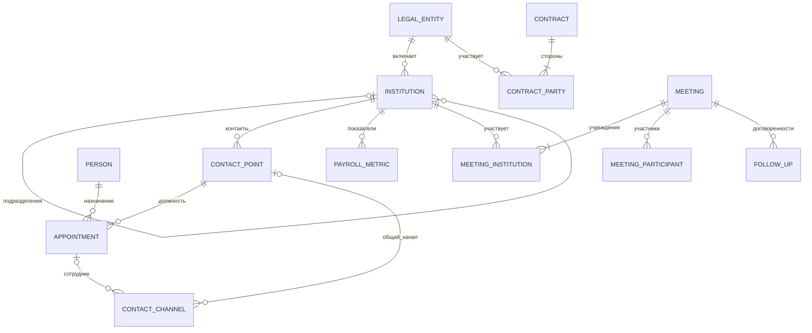

# База данных «Карточка ВУЗа» и объединение Excel по ИНН

Дата: 25 октября 2026 года. Статус: предложение для согласования. Документ описывает логическую модель и план работ; создание БД и миграция данных не выполнялись. Исходные материалы не изменялись.

## 1. Что установлено по материалам

| Источник | Наблюдение | Следствие |
|---|---|---|
| [Excel с контактными точками](material1/Копия%20ББ_2025_26%20уч%20год_кейс.xlsx), лист «ВУЗ ССУЗ», A2:H110 | 8 столбцов, 108 строк после заголовка. ИНН отсутствует. Название заполнено в 107 строках. E3:H110 полностью пусты | До объединения требуется восстановить ИНН. Нельзя создавать фиктивные ФИО и контакты |
| [Карточка ИКЭСТ](material1/Карточка_ИКЭСТ_2025.pptx), слайды 2–4 | Показатели учреждения, специальности, биография директора, вопросы о проектах | Показатели требуют даты; биография относится к человеку; вопросы не означают наличие проектов |
| [Карточка ИРНИТУ](material1/Карточка_ИРНИТУ%202026.pptx), слайды 1–2 | Карьерная история руководителя, незаполненные показатели, вопросы о сотрудничестве | Нужны история назначений и различение пропуска и нуля |
| [Локации](material1/Локации.pptx), слайд 1 | В извлечённом тексте — приглашение использовать Study AI Agent | Не использовать как справочник адресов; изображения и QR-код не анализировались |
| [README](vuz-card/README.md) и [спецификация](vuz-card/SPECIFICATION.md) | CRM и СУБД ещё выбираются; обновления проверяет сотрудник; финансовые данные отнесены к развитию | Модель независима от CRM. Финансовые таблицы включены по текущему запросу, но не становятся автоматически обязательными для Демо 1 |

Презентации изучены по тексту слайдов, Excel — по структуре и значениям ячеек. Файлов ФОТ, контрактов и протоколов встреч нет. Их структура ниже предложена для обсуждения, а не извлечена из существующих выгрузок. На одном Excel нельзя проверить массовое объединение разных отделов.

## 2. Принцип объединения

**ИНН объединяет сведения о юридическом лице. Карточка филиала или колледжа имеет собственный ID.**

По [разъяснению ФНС](https://www.nalog.gov.ru/rn77/fl/interest/inn/) ИНН российского юридического лица содержит 10 цифр, а для обособленных подразделений учитывается и КПП. Поэтому одинаковый ИНН не означает, что все строки относятся к одной площадке или одному контакту. КПП — дополнительный реквизит сопоставления; постоянный ключ карточки — внутренний ID.

Карточка собирается из связанных таблиц. Контакты, финансовые показатели, договоры и встречи не размещаются в одной широкой строке. Для всех принятых данных сохраняются источник, дата наблюдения и история изменений. Сырые данные отделены от очищенных. Повтор загрузки не должен создавать дубли.

### Соглашения о типах

- ID — UUID или стабильный ID выбранной CRM; PK — первичный ключ, FK — внешний ключ, UQ — уникальность. ИНН хранится строкой, а не числом.
- `text` — строка; `date` — дата; `timestamp` — время с часовым поясом; `decimal` — точное десятичное число; `?` — допустимый NULL. Остальные поля обязательны, если не оговорено иначе.
- У изменяемых бизнес-записей: `created_at`, `updated_at`, `created_by`, `updated_by`, `version`. Автор — пользователь или сервисная учётная запись CRM. Обновление проверяет версию.
- `verification_status`: pending / verified / conflict / rejected. В справку к встрече попадают проверенные значения; спорные показываются отдельно.
- Даты действия задают интервал [valid_from, valid_to). Неизвестные даты остаются NULL; время загрузки не подменяет дату вступления сведений в силу.
- Пустое значение не равно нулю и не является командой удалить ранее известное поле.

## 3. Предметные таблицы

### 3.1. legal_entity — юридическое лицо

| Поле | Тип | Назначение |
|---|---|---|
| id | ID, PK | Постоянный ключ |
| inn | text(10), UQ | Подтверждённый ИНН |
| official_name | text | Полное юридическое наименование |
| short_name | text? | Краткое наименование |
| ogrn | text(13)? | Проверенный ОГРН |
| head_kpp | text(9)? | КПП головной организации |
| legal_address | text? | Юридический адрес |
| status | enum | active / reorganized / closed / unknown |
| verified_at | timestamp | Проверка реквизитов |

ИНН проверяется по составу, длине и контрольной цифре. До подтверждения реквизитов запись остаётся в staging. Другой ИНН при реорганизации означает другое юридическое лицо; историю автоматически не переносить. Допускаются контрагенты, не являющиеся вузами, для хранения сторон договоров.

### 3.2. institution — карточка ВУЗа, СПО или подразделения

| Поле | Тип | Назначение |
|---|---|---|
| id | ID, PK | Ключ карточки |
| legal_entity_id | ID, FK | Юридическое лицо |
| parent_institution_id | ID, FK → institution? | Головная карточка |
| unit_code | text | Внутренний стабильный код подразделения |
| display_name | text | Название в интерфейсе |
| education_type | enum | university / spo / mixed / unknown |
| unit_type | enum | head / branch / college / other |
| kpp | text(9)? | Подтверждённый КПП подразделения |
| region_code, city, address | text? | Регион из справочника и фактическое местоположение |
| website, profile | text? | Проверенный сайт и краткое описание |
| owner_user_id | ID, FK → пользователь CRM? | Ответственный сотрудник |
| status | enum | active / inactive / unknown |

UQ(legal_entity_id, unit_code), запрет циклов родителей, одна головная карточка на юрлицо. Родитель и подразделение здесь принадлежат одному юрлицу. Колледж с собственным ИНН — отдельное юрлицо; связь с вузом при необходимости моделируется отдельно. КПП может отсутствовать и не заменяет ID.

### 3.3. institution_alias — варианты названия

`id` PK; `institution_id` FK; `alias_raw` text; `alias_normalized` text; `source_system` text; `external_id` text?; `valid_from/valid_to` date?.

Хранит сокращения, прежние названия и обозначения из отделов. Название не уникально глобально. Подтверждённый внешний ID уникален в пределах исходной системы.

### 3.4. contact_point — контактная точка

`id` PK; `institution_id` FK; `department_name` text?; `title_raw` text; `title_normalized` text?; `responsibility` text?; `point_type` enum(position / department / function); `verification_status` enum.

Примеры: ректор, проректор по учебной работе, центр карьеры. Запись существует без известного человека. Одного совпадения названия должности недостаточно для объединения разных подразделений.

### 3.5. person — человек

`id` PK; `full_name` text; `last_name/first_name/middle_name` text?; `biography` text?; `academic_degree` text?; `verification_status` enum.

ФИО не уникально. Не создавать человека из должности или непроверенных инициалов. Возраст и стаж со старого слайда не считаются текущими. Дата рождения не нужна для ключа контакта и не включается в обязательные поля.

### 3.6. appointment — история должностей

`id` PK; `person_id` FK; `contact_point_id` FK; `valid_from/valid_to` date?; `appointment_status` enum(current / former / unknown); `is_acting` boolean; `verified_at` timestamp?; `verification_status` enum.

При смене ректора создаётся новое назначение. Прежний человек и история встреч сохраняются. Несколько текущих лиц на единоличной должности вызывают проверку. Исчезновение ФИО со страницы не доказывает дату увольнения. Точный дубль назначения получает дополнительные источники, а не новую запись.

### 3.7. contact_channel — почта или телефон

`id` PK; `contact_point_id` FK?; `appointment_id` FK?; `channel_type` enum(email / phone); `value_raw` text; `value_normalized` text; `extension` text?; `contact_label` text?; `valid_from/valid_to` date?; `verification_status` enum; `verified_at` timestamp?.

Ровно один владелец: contact_point ИЛИ appointment. Общая почта центра не становится личной почтой директора. Несколько адресов/телефонов хранятся отдельными строками. Дубли проверяются по владельцу, типу, значению и периоду; глобальная уникальность телефона запрещена.

### 3.8. payroll_metric — ФОТ и связанные показатели

| Поле | Тип | Назначение |
|---|---|---|
| id | ID, PK | Ключ версии показателя |
| institution_id | ID, FK | Карточка, которой принадлежит показатель |
| metric_code | enum | payroll_fund / payroll_via_sber / employee_count / payroll_share |
| period_start, period_end | date | Период, обе границы включительно |
| period_kind | enum | month / quarter / year / custom / as_of |
| aggregation_kind | enum | period_total / ytd / snapshot / average |
| scope_code | text | Юрлицо со всеми филиалами либо определённое подразделение |
| population_code | text | Сотрудники, преподаватели или другая согласованная группа |
| scenario | enum | actual / plan / estimate |
| amount | decimal(20,2)? | Сумма в единицах валюты, без масштаба тысяч/миллионов |
| currency | text(3)? | Валюта суммы |
| count_value | decimal(18,4)? | Численность, в том числе средняя |
| ratio_value | decimal(12,8)? | Доля от 0 до 1 |
| methodology_code | text | Согласованная методика и состав выплат |
| revision_no | integer | Номер версии |
| supersedes_id | ID, FK → payroll_metric? | Предыдущая версия |
| is_current | boolean | Действующая версия |
| verification_status | enum | Статус проверки |

Заполнено ровно одно из amount/count_value/ratio_value согласно metric_code. Валюта обязательна только для суммы. Период корректен; суммы и численность неотрицательны, доля в [0,1]. Корректировки отдельными операциями здесь не моделируются.

Бизнес-ключ: учреждение + показатель + период и его тип + способ агрегации + периметр + группа + сценарий + методика + валюта для суммы. Одна текущая проверенная версия на ключ. При уникальности неденежных показателей NULL-валюта считается одним значением. Источник не входит в ключ: один факт из двух отделов не должен удваивать итог.

ФОТ и зарплатные перечисления через Сбер — разные показатели. Запрещено совместно суммировать год и месяцы, нарастающий итог и кварталы, план и факт, общий ФОТ вуза и уже включённые в него филиалы. Суммы с неизвестными единицами не принимаются до проверки.

### 3.9. contract — контракт или соглашение

`id` PK; `contract_type` enum(contract / agreement / additional_agreement); `number_raw` text?; `number_normalized` text?; `signed_on` date?; `subject` text; `valid_from/valid_to` date?; `status` enum(draft / active / completed / terminated / unknown); `amount` decimal(20,2)?; `currency` text(3)?; `amount_status` enum(known / unknown / not_applicable); `parent_contract_id` FK → contract?; `document_source_id` FK → source?; `verification_status` enum.

Номер не уникален глобально. Кандидат на дубль: номер + дата + вид + состав сторон; без номера требуется ручная проверка. amount обязателен при known, NULL при unknown/not_applicable; валюта обязательна для суммы. Допсоглашение хранится отдельно и не прибавляется автоматически к сумме основного договора. Суммы разных валют не складываются. Поддержка нескольких валют в одном договоре требует расширения отдельной таблицей сумм.

### 3.10. contract_party — стороны договора

`id` PK; `contract_id` FK; `legal_entity_id` FK; `institution_id` FK?; `party_role` text(customer / provider / partner / other).

UQ(contract_id, legal_entity_id, institution_id, party_role) с обработкой NULL как одного значения. Если указана карточка, она должна принадлежать legal_entity_id. При переводе из черновика сервер проверяет наличие минимум двух сторон. Когда конкретный филиал неизвестен, institution_id остаётся NULL, а договор выводится на уровне юрлица. Нельзя автоматически приписывать такой договор каждому филиалу.

### 3.11. meeting — история встреч

`id` PK; `title` text; `starts_at/ends_at` timestamp?; `date_precision` enum(exact / day / month / unknown); `format` enum(offline / online / hybrid / unknown); `location` text?; `status` enum(planned / held / cancelled / unknown); `agenda` text?; `summary` text?; `organizer_user_id` FK → пользователь CRM?; `external_system` text?; `external_event_id` text?; `minutes_source_id` FK → source?.

Если указан конец, он не раньше начала. Для даты с точностью до месяца не показывать вымышленное точное время. Пара external_system + external_event_id уникальна, когда оба поля заполнены. Совпадение названия и дня само по себе не доказывает дубль встречи.

### 3.12. meeting_institution и meeting_participant — связи и участники

- `meeting_institution`: `meeting_id` FK + `institution_id` FK — составной PK. Одна встреча может относиться к нескольким вузам. Для принятой встречи обязательна хотя бы одна карточка.
- `meeting_participant`: `id` PK; `meeting_id` FK; `person_id` FK?; `appointment_id` FK?; `user_id` FK → пользователь CRM?; `display_name_snapshot` text; `role_snapshot` text?; `institution_id` FK?; `attendance_status` enum(invited / attended / absent / unknown).

Участник может быть человеком из справочника, сотрудником CRM или участником из протокола без подтверждённой справочной записи. Если указано назначение, оно должно соответствовать person_id и учреждению. Снимки имени и роли сохраняют представление на момент встречи, несмотря на последующие кадровые изменения.

### 3.13. follow_up — договорённости

`id` PK; `meeting_id` FK; `institution_id` FK; `description` text; `owner_user_id` FK → пользователь CRM?; `due_on` date?; `status` enum(open / in_progress / done / cancelled); `completed_at` timestamp?; `result` text?.

Учреждение должно входить в meeting_institution. Для done обязательны дата завершения и результат. После выбора CRM эта сущность может соответствовать стандартной задаче.

## 4. Источники, импорт и история

| Таблица | Поля и ключи | Назначение |
|---|---|---|
| source | id PK; kind(excel/web/pptx/manual/document); uri; original_name?; sha256?; department_id?; source_date?; collected_at; access_class(public/internal/restricted) | Файл, сохранённая страница или ручной ввод. Хеш обязателен для файлов и снимков |
| source_record | id PK; source_id FK; locator; raw_payload JSON; raw_hash; UQ(source_id, locator) | Исходная строка Excel, слайд или фрагмент страницы. Locator содержит лист/строку; ячейка уточняется в наблюдении |
| import_batch | id PK; started_at; finished_at?; mapping_version; rules_version; status; initiated_by; counters JSON | Один запуск процесса с фиксированными правилами |
| staging_record | id PK; batch_id FK; source_record_id FK; row_type; normalized_payload JSON; candidate_inn?; matched_institution_id? FK; status; errors JSON; UQ(batch_id, source_record_id) | Промежуточная запись. Статусы ready / needs_review / rejected / applied |
| entity_registry | id PK; entity_type; business_id; UQ(entity_type, business_id) | Реестр ссылок на бизнес-записи для наблюдений и аудита. Создаётся в той же транзакции; соответствие типа реальной таблице проверяет сервер/триггер |
| field_observation | id PK; source_record_id FK; field_path; raw_value JSON; normalized_value JSON?; observed_at; effective_on?; target_record_id? FK → entity_registry; target_field?; review_status; reviewed_by?; reviewed_at?; decision_reason?; accepted_entity_version? | Найденное значение и решение о его принятии. Несколько источников могут подтверждать одно поле |
| data_quality_issue | id PK; staging_record_id? FK; observation_id? FK; rule_code; severity; description; status; assigned_to?; resolution?; resolved_at? | Очередь ошибок и конфликтов. Обязательна хотя бы одна ссылка на проблемный объект |
| change_log | id PK; entity_registry_id FK; field_name; old_value JSON; new_value JSON; changed_at; changed_by; reason; batch_id? FK; observation_id? FK; entity_version | Неизменяемый журнал принятых изменений |
| import_application | id PK; source_record_id FK; mapping_version; rules_version; output_key; entity_registry_id FK; applied_payload_hash; batch_id FK; UQ(source_record_id, mapping_version, rules_version, output_key) | Защита от повторного применения строки. Одна строка может создать несколько сущностей с разными output_key |

Дополнительные справочники: `region`, `department`, `metric_definition`, `import_mapping`. В metric_definition закрепляются смысл показателя, единицы и допустимая агрегация. В import_mapping — версия шаблона, строка заголовка, колонки и преобразования. Пользователи/роли берутся из CRM, отдельный справочник учётных записей не дублируется.

Наблюдение pending не меняет карточку. При принятии сервер в одной транзакции проверяет version, обновляет запись, отмечает принятое наблюдение и пишет change_log/import_application. Новые правила вызывают повторное сравнение с существующими бизнес-записями. Пропажа строки из новой выгрузки не удаляет автоматически контакт или встречу.

Одинаковое содержимое файла под разными именами не считается независимым фактом. Хранится одна версия содержимого и сведения о поступлении от отделов, например в source_receipt(id, source_id FK, department_id FK, original_name, received_at). Версия страницы или изменённого файла имеет другой хеш.

## 5. Маппинг имеющегося Excel

| Исходное поле | Целевое поле/сущность | Правило |
|---|---|---|
| A: «Регион » | institution.region_code | Нормализовать и сопоставить справочнику, сохранить оригинал |
| B: «Учебное заведение» | institution.display_name, institution_alias | Название помогает найти реквизиты, но не заменяет ИНН |
| C: «ВУЗ/СПО» | institution.education_type | «СПО Профессионалитет» разделить на тип СПО и отдельный признак программы; признак оставить в staging до проверки и расширения модели |
| D: «Точка контакта » | contact_point; иногда contact_channel/person | Разобрать смешанные должности, подразделения, почту и ФИО |
| E: «Контактное лицо» | person + appointment | Сейчас пусто; людей не выдумывать |
| F: «Эл. почта» | contact_channel(email) | Сейчас пусто |
| G: «Телефон» | contact_channel(phone) | Сейчас пусто |
| H: «адрес расположения» | institution.address | Сейчас пусто; не смешивать с юридическим адресом |
| ИНН/КПП | legal_entity.inn / institution.kpp | В исходнике колонок нет; требуется обогащение с подтверждением |

Особенности для пробной загрузки:

- A3: «Ирутская область» — кандидат на исправление по справочнику, с сохранением исходного текста.
- D19: email в угловых скобках, при пустом F19. Извлечь адрес как кандидат и проверить принадлежность учреждению; не создавать должность с названием почты.
- Строка 22: заполнена только D22. Связь с предыдущим учреждением можно предложить, но нельзя принимать без проверки структуры блока.
- C24: тип учреждения отсутствует. Предложить его из подтверждённой карточки, а не автоматически из соседней строки.
- D21: «Проектор по учебной работе» — вероятная опечатка; исправление по проверяемому словарю, а не произвольной догадке.
- B13, B51, B88:B89: колледж, территориальная площадка и вуз «в том числе колледж». До объединения проверить юридическую принадлежность и периметр показателей.

## 6. Пошаговый план сведения и очистки Excel

### Шаг 1. Зарегистрировать все источники

**Ответственные:** координатор данных и представители отделов.

Собрать оригиналы, владельцев, отделы, даты актуальности, назначение файлов, периоды и единицы показателей. Сохранить оригиналы без изменения, вычислить SHA-256, зарегистрировать source/source_receipt. Одинаковый файл под новым именем не должен создавать новый независимый факт.

**Результат:** реестр источников и владельцев. Вспомогательные выгрузки и отчёты размещаются вне vuz-card, например в project_vuz_card/data_work. В репозиторий могут попадать согласованные схемы, правила и обезличенные примеры.

### Шаг 2. Профилировать листы и строки

**Ответственный:** разработчик импорта.

Определить заголовки, скрытые листы/строки, объединённые ячейки, формулы, типы и форматы ячеек, пропуски, уникальные названия и повторения. Различить строки данных, заголовки, итоги, примечания и продолжения. Сохранить их происхождение; итоги не загружать как дополнительные ФОТ или учреждения.

Для формул учитывать формулу и сохранённый результат. Отсутствующий или устаревший результат направлять на пересчёт владельцу; не принимать за ноль. Не заполнять все пропуски предыдущим значением: перенос допустим только по подтверждённым правилам конкретного шаблона.

**Результат:** паспорт файла с числом строк по категориям и перечнем проблем.

### Шаг 3. Согласовать словарь данных

**Ответственные:** аналитик и владельцы данных отделов.

Зафиксировать поля, справочники, типы учреждений и подразделений. Для ФОТ определить состав выплат, включение взносов, периодичность, единицы, валюту, периметр, план/факт и способ агрегации. Для договоров — виды, стороны и нумерацию; для встреч — статусы, время и участников.

Определить владельца и приоритет источников по каждой группе полей. Разделить открытые и внутренние данные. Финансовые выгрузки не передавать в публичные поисковые сервисы.

**Результат:** словарь и условия сопоставимости. Пока смысл и единицы ФОТ неизвестны, суммы разных отделов не объединяются.

### Шаг 4. Описать маппинг каждого шаблона

**Ответственный:** разработчик; подтверждает владелец файла.

Сопоставить колонки полям, зафиксировать строку заголовка, правила разделения составных ячеек, период и единицы. Не связывать разные файлы по номеру строки. Новая структура заголовков требует новой версии маппинга. Неизвестные поля остаются в raw_payload.

**Результат:** воспроизводимые правила преобразования вместо ручного копирования.

### Шаг 5. Загрузить сырьё и нормализовать кандидатов

**Ответственный:** разработчик импорта.

Создать import_batch, source_record и staging_record. Убрать внешние/неразрывные пробелы, нормализовать переносы для поиска, сохранить оригинальные значения. Поисковые названия и ФИО хранить отдельно от отображаемых. Исправления регионов и должностей выполнять по журналируемым словарям.

ИНН читать строкой. Числовую ячейку принимать только при точном целочисленном значении допустимой длины; научную запись разбирать без округления. Не добавлять ведущие нули наугад. Неоднозначную дату 03/04/25 разбирать по согласованному формату источника.

Суммы приводить к единицам валюты: условные «12,5 млн руб.» → 12 500 000 руб., с сохранением исходного текста. Неизвестная валюта или масштаб блокируют принятие суммы. «—», «_», «нет данных» обрабатывать как пропуски по правилам шаблона; ноль сохранять как ноль. «Нет договора» — отдельное утверждение, а не пустая сумма.

Email очистить от обрамления, нормализовать домен; локальную часть не менять без правила. Телефон приводить к международному виду только при известной стране, добавочный хранить отдельно. Невалидные контакты не исправлять догадкой.

**Результат:** типизированные кандидаты и ошибки; рабочие карточки ещё не меняются.

### Шаг 6. Восстановить и подтвердить ИНН

**Ответственный:** оператор/владелец данных; парсер помогает искать кандидатов.

Найти официальные реквизиты по названию, региону, сайту и адресу; при необходимости сверить с реестровыми сведениями. Сохранить URL/снимок, дату, полное название, ИНН, КПП и основание сопоставления. Поисковая выдача и ответ ИИ сами по себе не подтверждают реквизиты.

Проверить 10 цифр и контрольный разряд, затем принадлежность организации. Правильная контрольная цифра не доказывает, что ИНН принадлежит нужному вузу. 12-значный ИНН не использовать как ключ юридического лица в этой модели, направить на разбор. Отсутствующий или спорный ИНН оставляет строку в needs_review.

**Результат:** подтверждённый реестр «вариант названия + регион/адрес → ИНН → подразделение». Для имеющегося Excel этот шаг обязателен, поскольку ИНН отсутствует во всём файле.

### Шаг 7. Сопоставить юридические лица и карточки

**Ответственные:** разработчик и оператор проверки.

| Ситуация | Действие |
|---|---|
| ИНН подтверждён, головное учреждение определено | Найти legal_entity по ИНН, привязать подтверждённую карточку |
| ИНН один, разные филиалы/колледжи | Одно юрлицо, несколько institution; подтвердить подразделения по реквизитам и адресу |
| ИНН один, подразделение неизвестно | Сохранить принадлежность юрлицу; не разносить данные по филиалам, сведения для конкретной карточки оставить на проверке |
| Название одинаковое, ИНН различаются | Не объединять; проверить одноимённые учреждения, ошибку и реорганизацию |
| ИНН отсутствует, название похоже | Сформировать кандидатов; принятие только после подтверждения |
| Принадлежность колледжа вузу предполагается по тексту | Проверить самостоятельность юрлица, не копировать ИНН головного вуза автоматически |

Нечёткое сравнение названий помогает выбрать кандидата, но не подтверждает его. GROUP BY ИНН с удалением остальных строк недопустим: он уничтожит филиалы, контакты и события.

**Результат:** справочник юрлиц и карточек плюс очередь неоднозначных сопоставлений.

### Шаг 8. Разобрать контакты и дубли фактов

**Ответственные:** разработчик и владельцы соответствующих разделов.

Разделить контактную точку, человека, назначение и каналы. Совпадение ФИО без дополнительных признаков не объединяет людей. Общий телефон или почта не доказывают тождество сотрудников. Смена должности создаёт историю, не переписывая старые встречи.

ФОТ сравнивать по полному бизнес-ключу: одинаковый факт из двух отделов получает два источника; разные суммы на одном ключе создают конфликт. Договоры сравнивать по сторонам, номеру, виду и дате. Встречи — по внешнему ID либо проверять дату, участников и учреждение. Не удалять строки только за повторение названия вуза.

**Результат:** список новых записей, подтверждённых дублей и конфликтов.

### Шаг 9. Разрешить противоречия

**Ответственный:** назначенный владелец данных по группе полей.

Приоритет устанавливается по полям: реквизиты — проверенный источник реквизитов; контакты — подтверждённые актуальные сведения; ФОТ — ответственный отдел за конкретную методику; договоры — документ/учётная карточка; встречи — протокол или календарный источник.

Дата получения файла не заменяет дату актуальности. Новый файл со старым периодом не перезаписывает свежие сведения. Не усреднять конфликтующие суммы и не выбирать первое значение. Пустая ячейка не стирает известное поле. Прекращение назначения, контакта или договора требует подтверждённого события.

**Результат:** у принятого значения есть источник, проверяющий, дата и причина решения; нерешённые значения остаются conflict.

### Шаг 10. Провести пробную загрузку без публикации

**Ответственный:** разработчик БД/импорта.

Сформировать dry run: что будет создано/обновлено, какие поля изменятся, какие строки исключены и почему. Начать с текущего Excel и нескольких подтверждённых организаций, включая филиалы и проблемные строки 19, 22, 24.

Для финансовых разделов и встреч нужны реальные образцы. До их получения допустима проверка структуры на явно синтетических данных, которые не попадают в рабочие карточки.

**Результат:** проверенный план изменений и очередь нерешённых вопросов.

### Шаг 11. Применить принятую часть

**Ответственный:** разработчик интеграции.

Порядок: справочники → legal_entity → institution/aliases → contact_point/person → appointment/contact_channel → payroll_metric → contract/contract_party → meeting/участники/связи → follow_up.

Использовать серверный API согласно SPECIFICATION.md: парсер не пишет напрямую в рабочую БД CRM. Применять связанные изменения транзакционно с контролем version, FK и бизнес-правил. import_application предотвращает повторное применение. После частичного сбоя повтор обрабатывает неприменённую часть.

Откат партии использует журнал и проверяет последующие версии: нельзя отменой старого импорта затереть более позднее ручное изменение.

**Результат:** рабочие записи, история и отчёт применения.

### Шаг 12. Сверить результат и повторить загрузку

**Ответственные:** разработчик и владельцы данных.

Все исходные строки должны получить взаимоисключающий итог: применено / подтверждённый дубль / требует проверки / отклонено / служебная строка. Сумма этих количеств равна числу зарегистрированных строк. Одна строка может создать несколько бизнес-записей, поэтому количество контактов не обязано совпадать с количеством строк.

Суммы ФОТ сверять только при одинаковых периодах, единицах, сценариях, методиках и непересекающихся периметрах. Дубли источников исключать. Каждое расхождение объяснить в отчёте. Проверить связи с юрлицами, сохранность старых назначений, отсутствие вымышленных людей.

Повторить ту же партию: количество записей и суммы не меняются. Изменить файл: применяется только подтверждённое изменение с историей. Смоделировать параллельную ручную правку: должен возникнуть конфликт версии.

**Результат:** акт сверки и подтверждение идемпотентности — безопасного повторного запуска.

### Шаг 13. Настроить регулярное обновление

**Ответственные:** координатор и владельцы данных.

Назначить расписание поступления файлов и проверки источников, правила устаревания по полям, владельцев очереди конфликтов и отчёт качества. Дату проверки показывать в карточке. Неизвестную структуру нового шаблона не применять до обновления маппинга.

**Результат:** повторяемый процесс с ответственными, вместо разовой ручной склейки.

## 7. Критерии приёмки

| Проверка | Ожидаемый результат |
|---|---|
| Один подтверждённый ИНН, два подразделения | Одно юрлицо, две карточки; контакты не смешаны |
| ИНН отсутствует или ошибочен | Запись в очереди проверки, организация не создаётся догадкой |
| Есть только должность | Создаётся contact_point, фиктивного человека нет |
| Email записан в должности | Выделен кандидат канала, принадлежность проверена |
| Сменился ректор | Новое назначение; история прежнего руководителя сохранена |
| Два отдела передали одинаковый ФОТ | Одна принятая версия с несколькими источниками, сумма не удвоена |
| Один ключ ФОТ, разные суммы | Видимый конфликт, без усреднения и произвольного выбора |
| Годовой ФОТ вместе с месяцами | Совместная агрегация заблокирована |
| Одинаковые номера разных договоров | Проверены стороны, дата и вид, ложного объединения нет |
| Встреча с двумя вузами | Одна встреча с двумя связями |
| Повтор той же загрузки | Нет новых бизнес-записей и повторного применения |
| Изменение принятого поля | Сохранены прежнее значение, источник, автор и причина |

Для принятой части все юридические лица имеют подтверждённый ИНН; нет нарушенных FK; все принятые импортированные значения имеют происхождение; непринятые строки учтены. Наличие очереди проверки допустимо, скрытая потеря строк — нет.

## 8. Индексы и адаптация к CRM

Минимальные индексы: уникальный legal_entity.inn; FK на связях; institution(legal_entity_id, unit_code); нормализованные aliases; appointment(contact_point_id, appointment_status); contact_channel(channel_type, value_normalized); payroll_metric по бизнес-ключу и периоду; contract по номеру/дате; contract_party по сторонам; meeting(starts_at); meeting_institution(institution_id, meeting_id); staging_record(batch_id, status); очередь ошибок по status; change_log(entity_registry_id, entity_version).

Физические типы, частичные уникальные индексы, сравнение NULL, контроль интервалов и реестр полиморфных ссылок определяются после выбора СУБД. Это логическая спецификация, а не готовый DDL. Обязательные ограничения реализуются в БД, где это возможно, а межстрочные правила — транзакционно на сервере/триггерами.

Стандартные сущности выбранной CRM (организации, контакты, встречи, задачи, аудит) нужно сопоставить этой модели и расширить недостающими полями вместо создания второго независимого справочника. Принятые данные имеют один источник истины. Отдельное хранилище парсера содержит сырьё и кандидатов, а не конкурирующие рабочие карточки.

ФОТ, внутренние договоры и протоколы имеют отдельные права. Класс доступа источника учитывается в производных сведениях, карточке и презентациях. Открытые контакты не делают финансовые разделы открытыми.

## 9. Что уточнить перед реализацией

1. Какая CRM и СУБД выбраны и какие стандартные сущности можно использовать?
2. Какие отделы передают данные и кто разрешает противоречия по каждому разделу?
3. Что означает ФОТ в каждой выгрузке: состав выплат, период, периметр, методика, валюта, масштаб и факт/план?
4. Какие филиалы, колледжи и площадки требуют отдельных карточек и как подтверждается их юридическая принадлежность?
5. Есть ли реальные образцы файлов ФОТ, договоров и встреч, стабильные внешние ID и согласованные статусы?
6. Какие сведения об участниках и договорённостях обязательны?
7. Что необходимо для Демо 1, а что достаточно пока предусмотреть в модели?

Следующий практический шаг — подтвердить реестр «название → ИНН → подразделение» для текущего Excel и согласовать словарь ФОТ на реальной выгрузке. После этого можно готовить физическую схему и первый маппинг импорта без предположений о недостающих данных.
